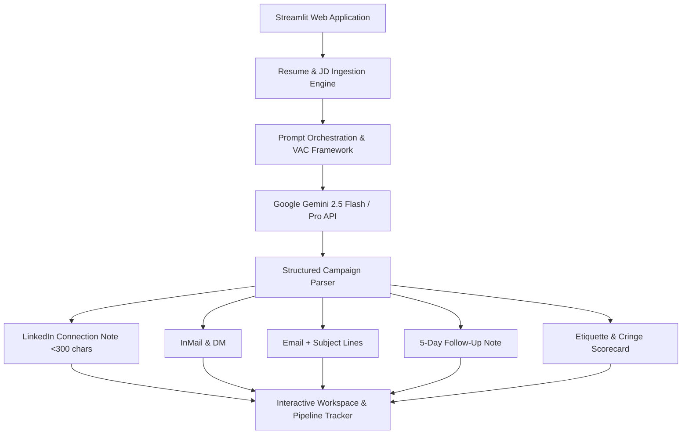

# 🚀 ReferralCraft AI (v2.0)
### *Turn Cold Job Applications into High-Converting Employee Referrals*

[](https://streamlit.io)
[](https://aistudio.google.com)
[](https://python.org)
[](https://opensource.org/licenses/MIT)

---

## 💡 Overview

Securing an employee referral makes a candidate **4x more likely to be interviewed** and **8x more likely to be hired**. Yet **85%+ of cold outreach messages fail** because they are either generic copy-pastes, overly desperate in tone, or violate platform constraints (such as LinkedIn’s hard 300-character limit on connection requests).

**ReferralCraft AI 2.0** is an enterprise-grade referral strategy and outreach generator. It synthesizes candidate resumes, target job descriptions, and referrer profiles into an omni-channel outreach campaign—complete with an automated **AI Etiquette & "Cringe" Audit** to ensure your outreach reads like a confident, capable peer.

---

## ✨ Key Product Features

### 1. 📬 Omni-Channel Outreach Suite
One click generates 5 tailored communication assets:
- **🔗 LinkedIn Connection Note**: Strictly enforced to remain **under 290 characters** so it fits within free LinkedIn connection limits without awkward truncation.
- **💬 LinkedIn InMail / Direct Message**: 100–140 words balancing common ground, technical alignment, and a frictionless ask.
- **📧 Cold / Warm Email**: 3 high-converting subject line options with a cleanly structured email body.
- **⏱️ 5-Day Follow-Up Sequence**: A gentle, polite nudge that recovers the 60% of referrals that get buried in busy inboxes.
- **🎙️ 30-Second Audio Note Script**: Script for sending voice notes on the LinkedIn mobile app (shown to yield 3x higher response rates).

### 2. 🛡️ AI Etiquette & "Cringe" Audit
- **Desperation Index (1–10)**: Detects and eliminates needy or begging language, re-framing asks into confident peer-to-peer dialogues.
- **Personalization & Brevity Scores**: Evaluates message relevance and readability.
- **Executive Coach Critique**: Highlights key psychological levers and provides actionable tips before you hit send.

### 3. 📄 Smart Resume & JD Ingestion
- Upload PDF or TXT resumes for instant extraction using `pypdf`.
- Matches your core achievements with target job description keywords.

### 4. ⚡ 1-Click Interactive Rewriters
- Rewrite notes on the fly: *"Shorten by 15%"*, *"Make Punchier"*, *"Make Warmer & Casual"*, or *"Executive Peer-Level"*.

### 5. 📊 Mini Referral Pipeline Tracker
- Track contacts, companies, roles, outreach dates, and response statuses directly in your session.
- Export pipeline data to CSV for personal career tracking.

---

## 👥 Target User Personas

| Persona | Core Pain Point | Tailored Solution |
| :--- | :--- | :--- |
| **Aarav (New Grad / Junior Seeker)** | Intimidated by senior engineers; copy-pasting generic requests. | *Alumni affinity hook + strict <300 char connection invite.* |
| **Elena (Mid-Career Switcher)** | Transitioning industries; needs to frame transferable skills. | *Transferable impact synthesizer + warm mutual contact tone.* |
| **Marcus (Senior / Staff / Exec)** | Reaching out directly to VPs and Directors; hates fluff. | *High-signal peer-to-peer executive framing.* |
| **Priya (International / Visa Seeker)**| Anxious about cultural norms and overly formal phrasing. | *Modern Silicon Valley conversational etiquette calibrator.* |

---

## 🏗️ System Architecture



---

## 🚀 Quick Start Guide

### Prerequisites
- Python 3.10 or higher
- A free Google Gemini API Key from [Google AI Studio](https://aistudio.google.com)

### 1. Clone the Repository
```bash
git clone https://github.com/jaiviksedsvit-coder/ReferralMaker.git
cd ReferralMaker
```

### 2. Install Dependencies
```bash
pip install -r requirements.txt
```

### 3. Launch the Application
```bash
streamlit run app.py
```
*The app will automatically launch at `http://localhost:8501` in your browser.*

### 4. Configure Your API Key
- Enter your Gemini API key in the left sidebar, or export it in your terminal:
```bash
export GEMINI_API_KEY="your-api-key-here"
```

---

## 📈 Product KPIs & Quality Metrics

1. **Referral Engagement Rate (RER)**: Target **>35%** positive response rate (vs. industry benchmark of 8–12%).
2. **Character Compliance**: **100%** compliance for LinkedIn connection notes remaining ≤300 characters.
3. **Desperation Mitigation**: Average Desperation Index score of **≤ 2.5 / 10** across generated drafts.
4. **Generation Latency**: Under **4.0 seconds** using Gemini 2.5 Flash.

---

## 🗺️ Product Roadmap

- [x] **v2.0**: Multi-channel generation, Etiquette audit, Resume PDF parsing, Pipeline tracker.
- [ ] **v2.1**: LinkedIn Profile URL auto-scraping via official APIs or authenticated webhooks.
- [ ] **v2.2**: Email integration (Gmail / Outlook 1-click draft creation).
- [ ] **v3.0**: Chrome Extension for 1-click extraction directly while browsing LinkedIn job postings.

---

## 📄 License
This project is open-source under the [MIT License](LICENSE).
