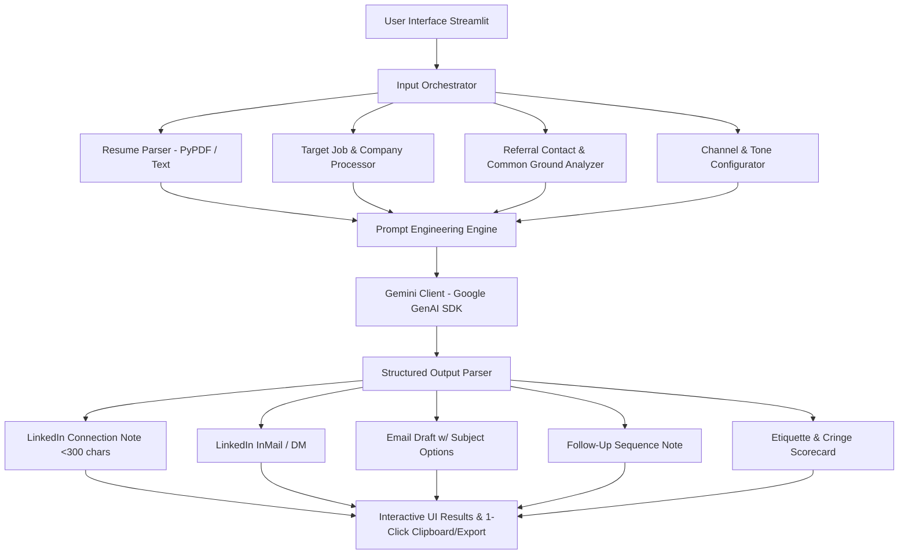
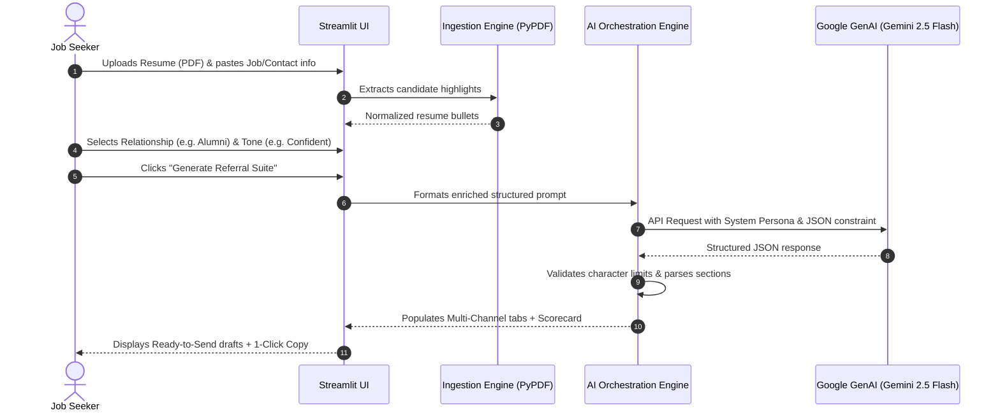

# System Architecture & Technical Specification: ReferralCraft AI 2.0

## 1. System Overview

ReferralCraft AI 2.0 is a modular, privacy-conscious AI outreach generation platform. Built on Python and Streamlit, it leverages Google's Gemini models (`gemini-2.5-flash` for high-speed multi-channel generation and `gemini-2.5-pro` for deep career synthesis) via the new `google-genai` SDK.

---

## 2. Component Architecture

### 2.1 Layer Breakdown

1. **Presentation Layer (`app.py` & `utils/styles.py`)**:
   - Modern, executive theme with custom CSS design tokens.
   - Live character counting gauges with color-coded safety indicators (< 280 safe, 280-300 warning, > 300 alert).
   - Tabbed workspace:
     - *Generator Suite* (Inputs + Dynamic Form)
     - *Campaign Results* (Multi-channel tabs, 1-click copy, download)
     - *Scorecard & Critique* (Desperation index, value score, coach tips)
     - *Outreach Tracker (Mini CRM)* (Track referral pipeline locally)

2. **Parsing & Ingestion Engine (`utils/parser.py`)**:
   - In-memory PDF text extraction using `pypdf`.
   - Markdown and raw text normalization.
   - Automatic extraction of high-impact skills, tenure, and recent achievements.

3. **AI Orchestration & Prompt Engineering (`utils/ai_engine.py`)**:
   - Built on `google-genai` SDK (`from google import genai`).
   - Supports model switching (`gemini-2.5-flash`, `gemini-2.5-pro`, `gemini-2.0-flash`).
   - System prompts equipped with:
     - Strict character length constraints for LinkedIn connection notes.
     - Anti-desperation & peer-level framing directives.
     - Structured JSON response generation (`response_schema` or structured JSON block) to guarantee parsing reliability.

4. **Security & State Management Layer**:
   - BYOK (Bring-Your-Own-Key) support with fallback to `st.secrets` and `os.environ["GEMINI_API_KEY"]`.
   - Session-isolated state (`st.session_state`), preventing cross-user data leakage.
   - Ephemeral memory processing: Resumes and inputs are cleared upon session teardown.

---

## 3. Data Flow Diagram

---

## 4. Prompt Engineering Principles

To ensure referral notes convert at an industry-leading rate, the prompt architecture adheres to the **"V-A-C" Framework**:

1. **V - Value First**: Never start with "I need a referral". Start with genuine admiration, common ground, or an informed observation about the recipient's work or company.
2. **A - Alignment**: Seamlessly draw a 1-sentence parallel between the sender's strongest achievement and the target team's mission.
3. **C - Frictionless Call to Action (Soft Ask)**: Ask for advice, a 10-minute perspective chat, or whether they feel comfortable passing along the resume, rather than an aggressive "submit my application right now".

### LinkedIn Connection Request Rule (<300 Characters)
A hard enforcement prompt instructs the model to count characters and stay strictly below 290 characters to account for spacing differences, ensuring non-premium LinkedIn users never get truncated.

---

## 5. Error Handling & Resilience
- **Model Fallbacks**: If a selected model experiences rate limits or downtime, the client gracefully falls back to `gemini-2.5-flash`.
- **JSON Parsing Safeguards**: If the model output fails strict JSON parsing, a secondary regex extractor parses sections cleanly without breaking the UI.
- **Graceful API Key Missing**: Clear sidebar guidance with direct link to Google AI Studio for obtaining a free key.
